<div align="center">


# AntCloud for macOS

**Your AntCloud gaming PC, one click away on your Mac.**<br>
Start the cloud PC, watch it boot, and play. Pairing with Moonlight happens on its own.

<p>
  
  
  
  
  
</p>

<p><a href="#the-whole-session-in-one-window">Screenshots</a> &nbsp;·&nbsp; <a href="#getting-started">Getting started</a> &nbsp;·&nbsp; <a href="#an-overlay-while-you-play">Overlay</a> &nbsp;·&nbsp; <a href="#how-it-works">How it works</a> &nbsp;·&nbsp; <a href="#project-layout">Project layout</a></p>

</div>

> [!IMPORTANT]
> **Unofficial project.** This is an independent client built by a user. It is not made, endorsed or supported by AntCloud.
> "AntCloud" and the AntCloud logo belong to their owners. Use it with your own AntCloud account, and follow AntCloud's terms of service.

<br>

<p align="center">
  <picture><source media="(prefers-color-scheme: dark)" srcset=".github/screenshots/dark-login.png">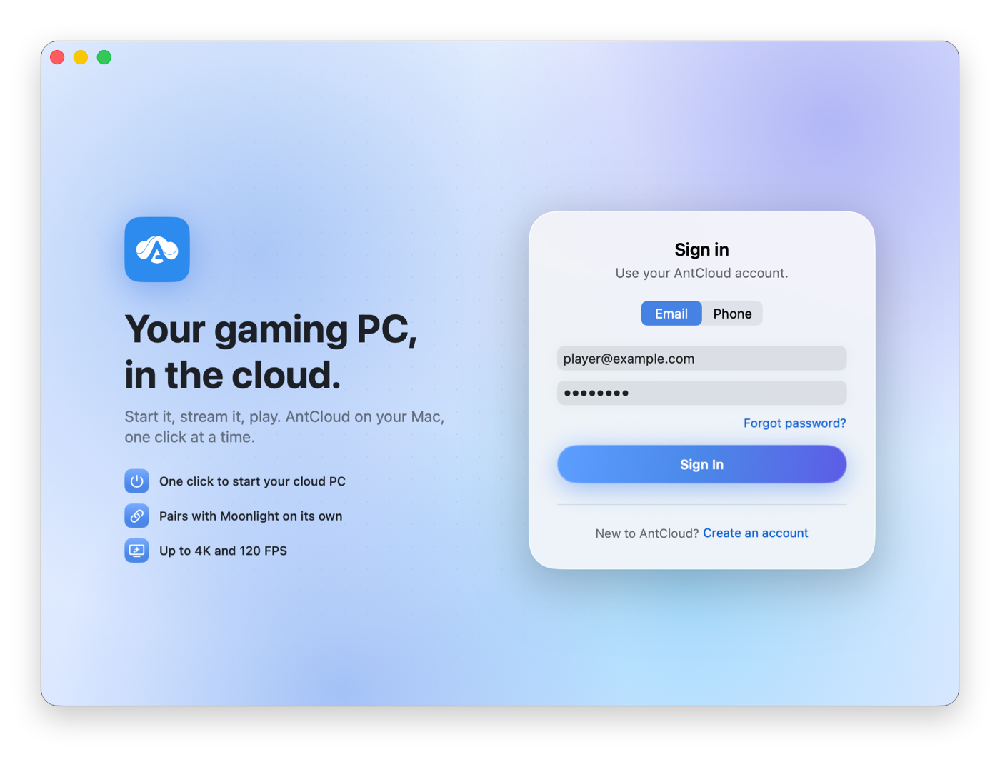</picture>
</p>

<br>

## The whole session in one window

The home screen is built around one question: what is my cloud PC doing right now?
A drawn monitor shows the answer, the track below it shows how far along you are, and there is only ever one main button.

<table>
  <tr>
    <td width="33%" valign="top">
      <picture><source media="(prefers-color-scheme: dark)" srcset=".github/screenshots/dark-step-idle.png">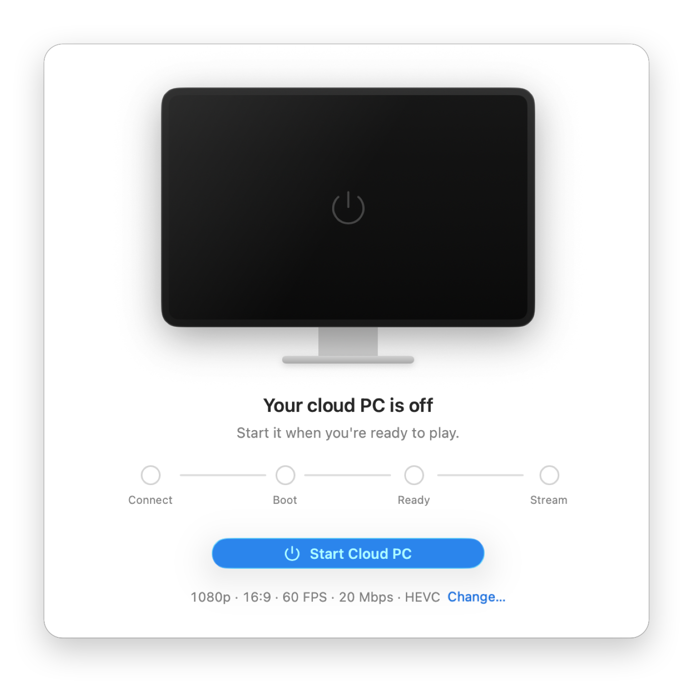</picture>
      <p align="center"><b>Off</b><br><sub>One button to start.</sub></p>
    </td>
    <td width="33%" valign="top">
      <picture><source media="(prefers-color-scheme: dark)" srcset=".github/screenshots/dark-step-queued.png">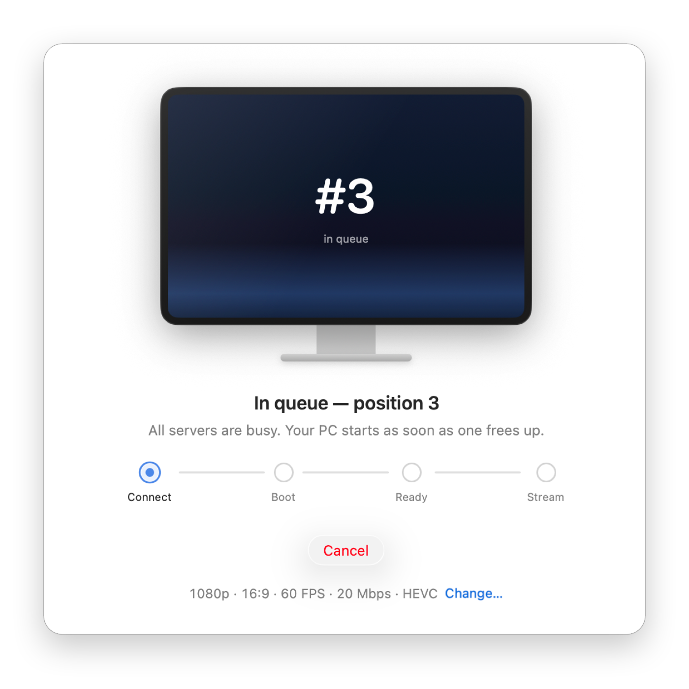</picture>
      <p align="center"><b>In the queue</b><br><sub>Your live position while servers are busy.</sub></p>
    </td>
    <td width="33%" valign="top">
      <picture><source media="(prefers-color-scheme: dark)" srcset=".github/screenshots/dark-step-booting.png">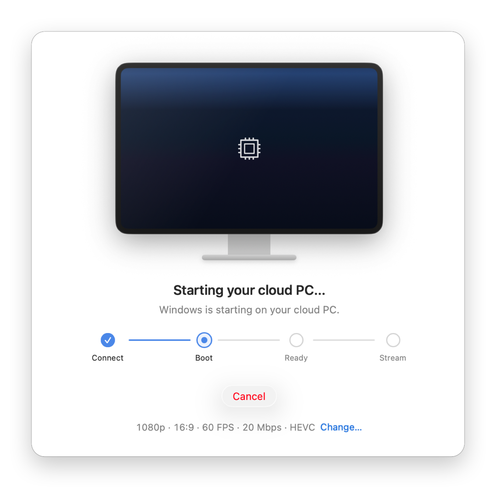</picture>
      <p align="center"><b>Booting</b><br><sub>Windows starts on the cloud PC.</sub></p>
    </td>
  </tr>
  <tr>
    <td width="33%" valign="top">
      <picture><source media="(prefers-color-scheme: dark)" srcset=".github/screenshots/dark-step-ready.png">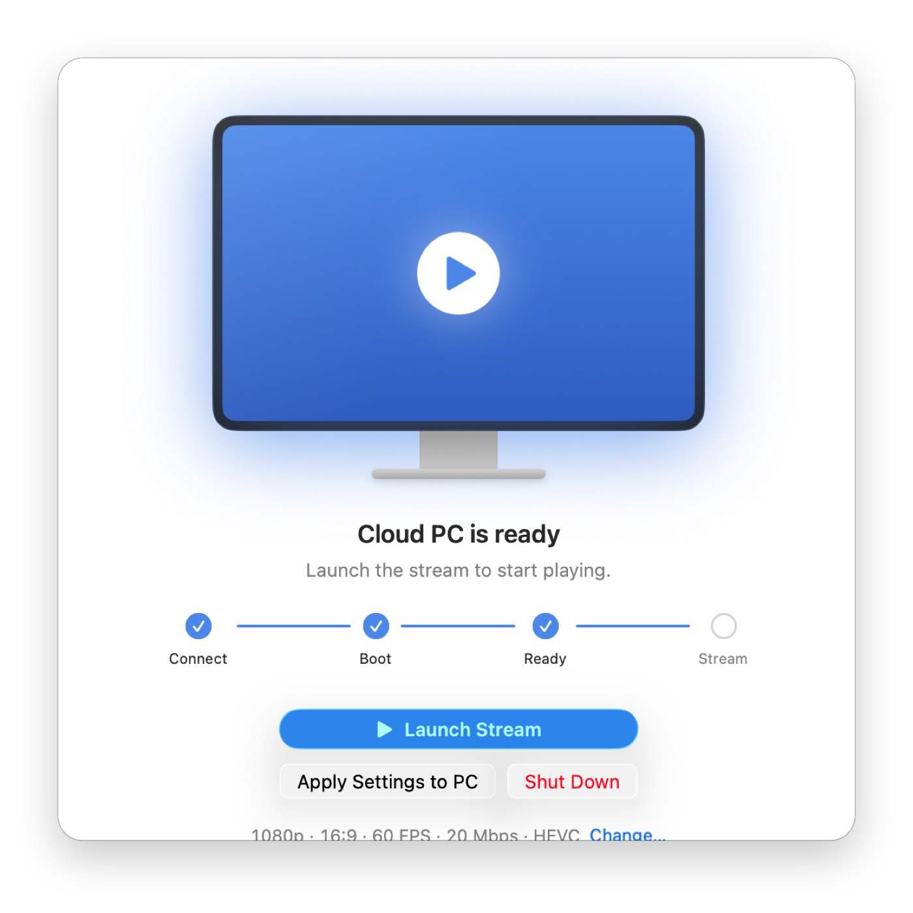</picture>
      <p align="center"><b>Ready</b><br><sub>Launch the stream when you are.</sub></p>
    </td>
    <td width="33%" valign="top">
      <picture><source media="(prefers-color-scheme: dark)" srcset=".github/screenshots/dark-step-pairing.png">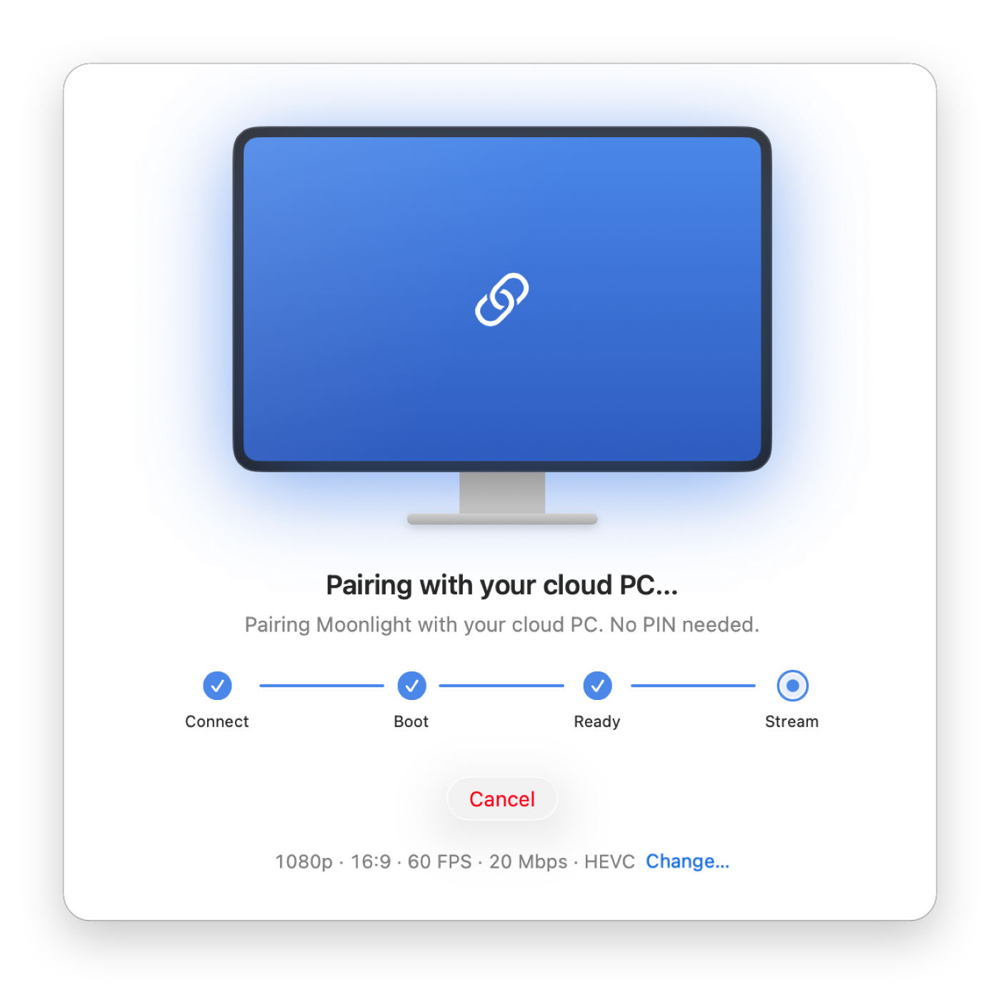</picture>
      <p align="center"><b>Pairing</b><br><sub>Moonlight pairs itself. No PIN to type.</sub></p>
    </td>
    <td width="33%" valign="top">
      <picture><source media="(prefers-color-scheme: dark)" srcset=".github/screenshots/dark-step-streaming.png">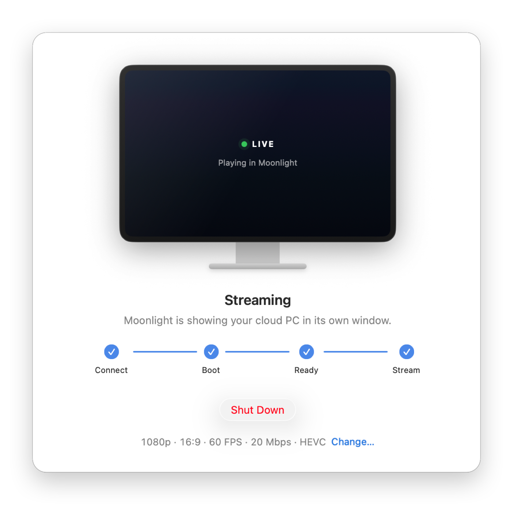</picture>
      <p align="center"><b>Streaming</b><br><sub>You're playing. The app waits in the background.</sub></p>
    </td>
  </tr>
</table>

## Stream settings that explain themselves

<table>
  <tr>
    <td width="42%" valign="top">
      <p>Grouped like System Settings, with the numbers that matter right under each choice.</p>
      <ul>
        <li><b>Display:</b> 720p to 4K, 16:9, 16:10 or 21:9, and fullscreen that also sends ⌘Tab to the cloud PC. Shows the exact stream size, e.g. 1920 × 1200.</li>
        <li><b>Performance:</b> 30, 60 or 120 FPS and 5 to 50 Mbps, with the most data you'll use per hour.</li>
        <li><b>Codec &amp; audio:</b> HEVC for a sharper picture at the same bitrate, and microphone forwarding.</li>
      </ul>
      <p>Settings lock while you're streaming, and the home screen always shows a one-line summary such as <code>1080p · 16:9 · 60 FPS · 20 Mbps · HEVC</code>.</p>
    </td>
    <td width="58%" valign="top">
      <picture><source media="(prefers-color-scheme: dark)" srcset=".github/screenshots/dark-settings.png">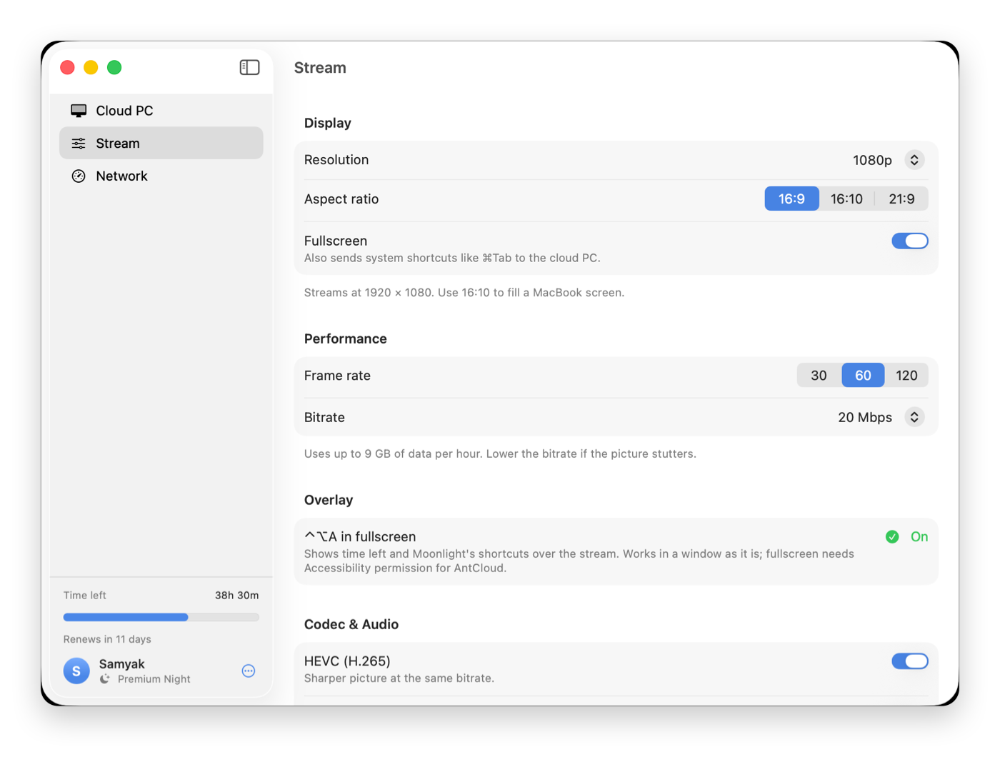</picture>
    </td>
  </tr>
</table>

## Check your connection before you start

<table>
  <tr>
    <td width="58%" valign="top">
      <picture><source media="(prefers-color-scheme: dark)" srcset=".github/screenshots/dark-network.png">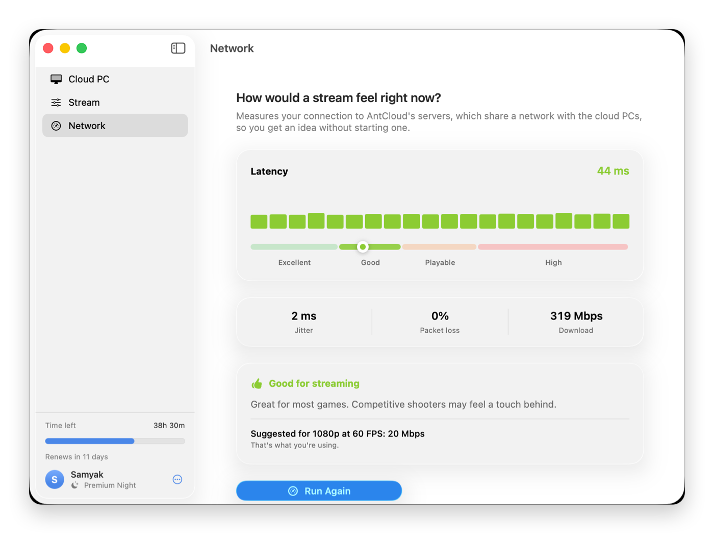</picture>
    </td>
    <td width="42%" valign="top">
      <p>The <b>Network</b> pane tells you how a stream would feel without starting the cloud PC.</p>
      <ul>
        <li><b>Latency</b> to AntCloud's servers, which share a network with the cloud PCs, so it's a close stand-in for the real thing. Twenty samples fill in live and a marker settles on Excellent, Good, Playable or High.</li>
        <li><b>Jitter, packet loss and download speed</b>, the last measured through Cloudflare.</li>
        <li><b>A plain verdict</b> and the bitrate your resolution and frame rate actually need, with one click to use it.</li>
      </ul>
    </td>
  </tr>
</table>

## An overlay while you play

<p align="center">
  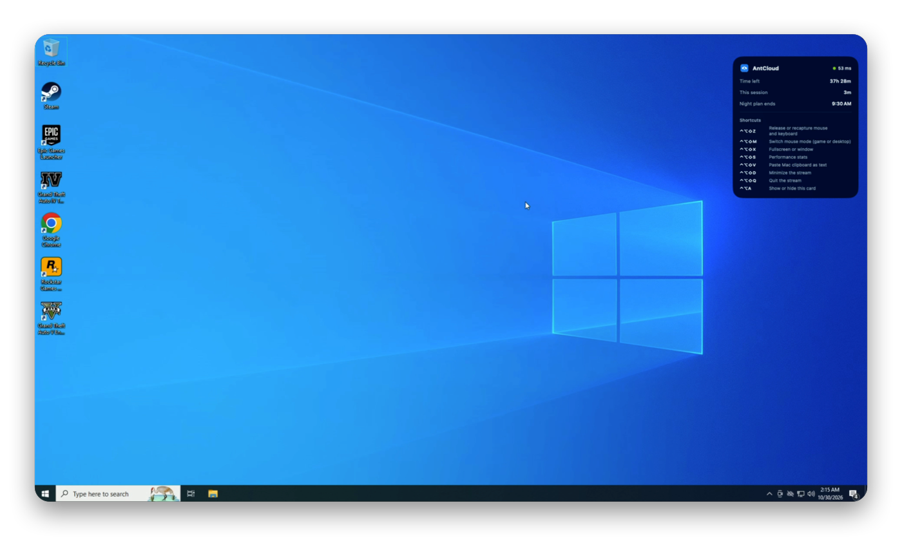
</p>

<table>
  <tr>
    <td width="40%" valign="top">
      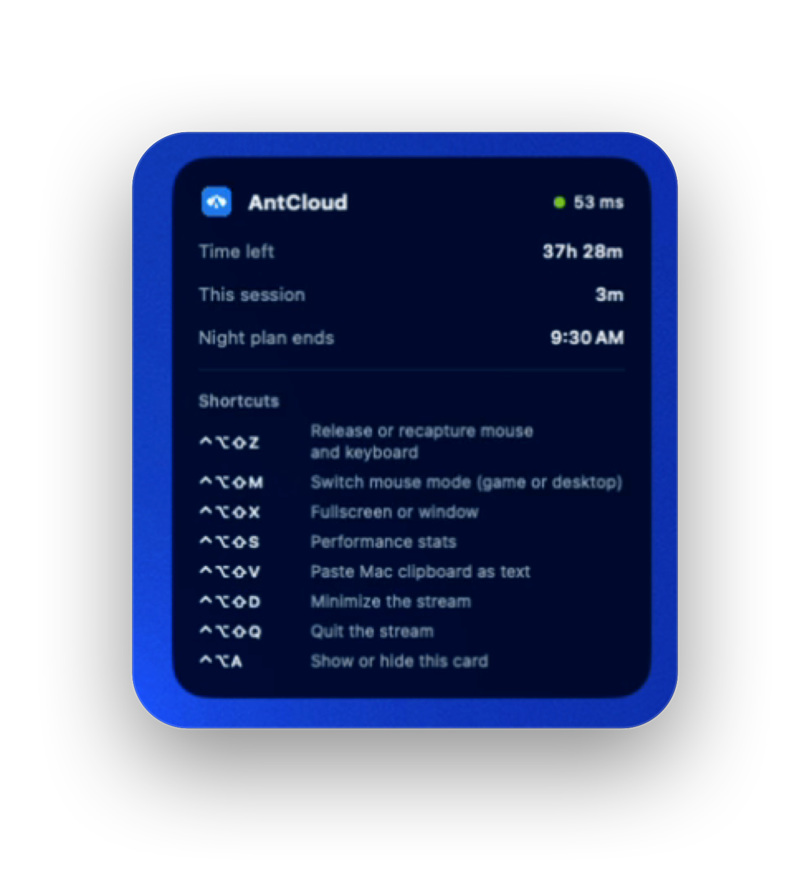
    </td>
    <td width="60%" valign="top">
      <p>Press <kbd>⌃</kbd><kbd>⌥</kbd><kbd>A</kbd> during a stream, in a window or fullscreen, for a small glass card over the game:</p>
      <ul>
        <li><b>Time left</b> on your plan, counting down, and how long this session has run</li>
        <li><b>When a night plan ends</b> and your <b>live latency</b> to the cloud PC</li>
        <li><b>Moonlight's own shortcuts</b>, so you don't have to remember them: release the mouse, switch mouse mode, fullscreen, stats, paste, minimize, quit</li>
      </ul>
      <p>It never takes the keyboard or mouse from the game. It also speaks up on its own when the cloud PC's connection gets busy (a game download on it doubled latency in testing) and when 10 minutes of plan time are left.</p>
      <p><sub>Fullscreen needs Accessibility permission for AntCloud: Stream → Overlay → Allow…</sub></p>
    </td>
  </tr>
</table>

## Light and dark

The app follows your Mac's appearance. AntCloud blue is the only accent colour.

<table>
  <tr>
    <td width="50%">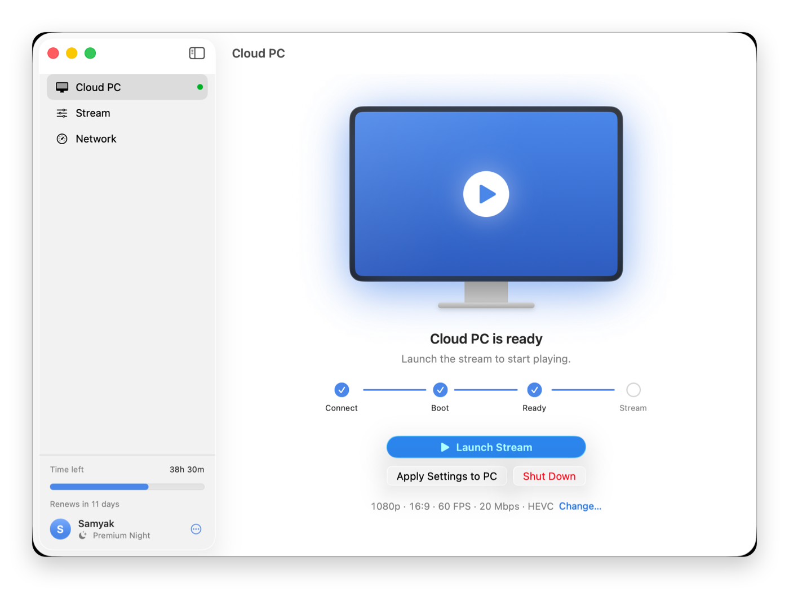</td>
    <td width="50%">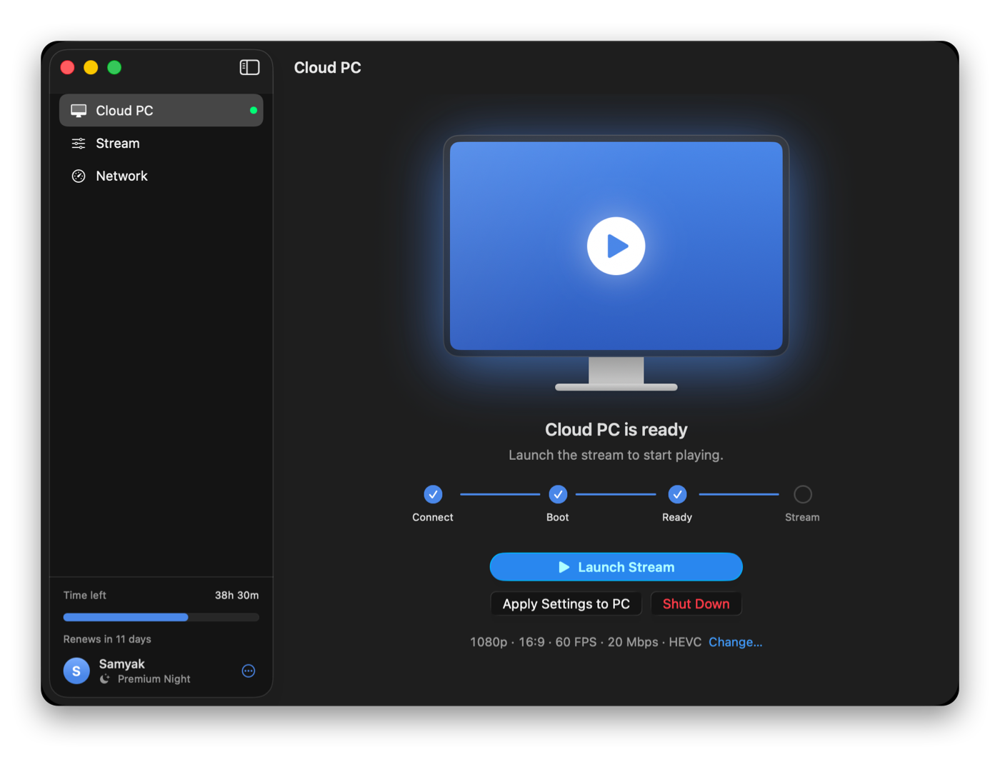</td>
  </tr>
  <tr>
    <td width="50%">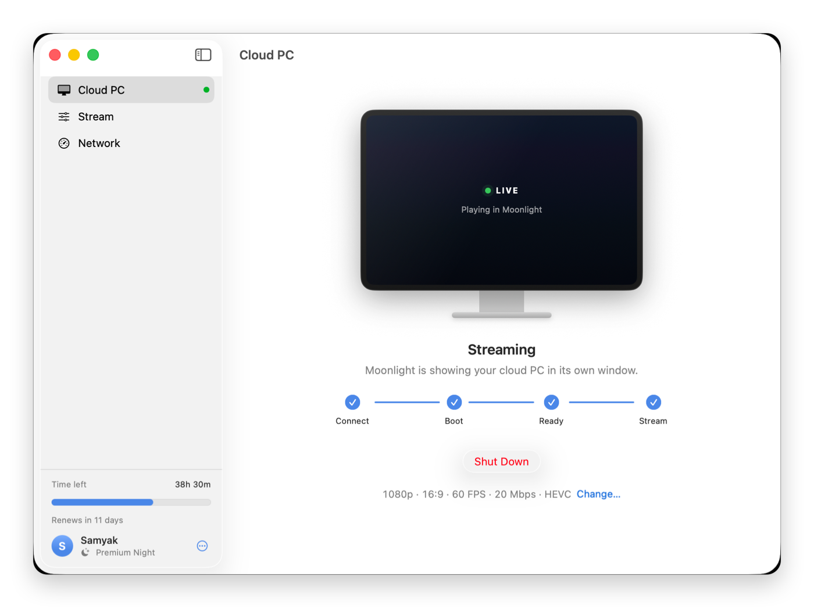</td>
    <td width="50%">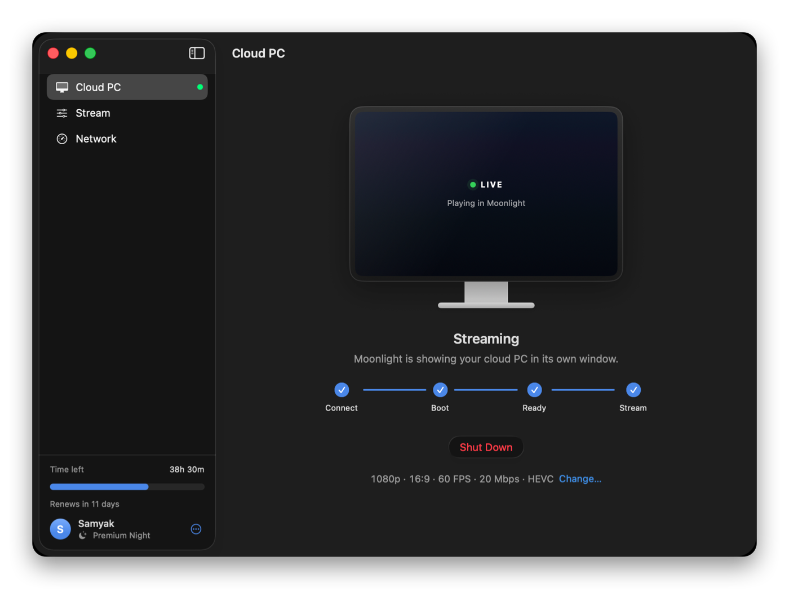</td>
  </tr>
</table>

## Features

- **Sign in** with email and password or a phone code. Tokens are kept in the macOS Keychain.
- **One-click cloud PC.** Handles the queue, the boot and the readiness checks.
- **Automatic pairing.** The app generates the PIN and sends it to AntCloud, so Moonlight pairs without any typing.
- **Your plan in the sidebar.** Time left this month, the renewal date and a readable plan name, like "Premium Night".
- **Microphone forwarding** to the cloud PC.
- **Night-plan aware.** Checks the server clock before starting, so outside 12:30–9:30 AM IST it tells you
  instead of booting the PC, and ends the session at the plan's cutoff like the official client.
- **Network check** without starting the cloud PC: latency to AntCloud's servers (which share a network with the
  cloud PCs), jitter, packet loss and download speed, with a verdict and a bitrate suggestion for your settings.
- **In-stream overlay:** press **⌃⌥A** during a stream for a small card with time left, session length,
  night-plan end, live latency and Moonlight's own shortcuts. It warns you on its own when the cloud PC's connection
  gets busy (a game download, say) and when 10 minutes of plan time are left. Fullscreen needs Accessibility
  permission for AntCloud (Stream → Overlay → Allow…); a window works without it.
- **Liquid Glass on macOS 26,** with a frosted fallback on earlier versions.
- **Motion with a purpose:** the monitor powers on, the track fills step by step, time left counts up,
  and a failed sign-in shakes. Reduce Motion turns it all into simple fades.

## Getting started

You need macOS 13 or later, Swift 5.9 or later (the Command Line Tools are enough), and
[Moonlight](https://moonlight-stream.org):

```sh
brew install --cask moonlight
```

Then run or build the app:

```sh
swift run                            # run in development
scripts/build-app.sh                 # build AntCloud.app (needed for the microphone permission prompt)
scripts/build-app.sh --bundle-moonlight   # also embed /Applications/Moonlight.app in the bundle
```

<details>
<summary><b>Preview mode</b>, for working on the UI</summary>
<br>

Debug builds can open any screen with a sample account, without touching your Keychain or the API.
This is how the screenshots above were made.

```sh
ANTCLOUD_PREVIEW=home:ready swift run
ANTCLOUD_PREVIEW=login ANTCLOUD_APPEARANCE=light ANTCLOUD_SNAPSHOT=login.png swift run
```

| Variable | Values |
|---|---|
| `ANTCLOUD_PREVIEW` | `login`, `home:idle`, `home:queued`, `home:booting`, `home:ready`, `home:pairing`, `home:streaming`. Add `:stream` for the settings pane. |
| `ANTCLOUD_APPEARANCE` | `light` forces light mode |
| `ANTCLOUD_SNAPSHOT` | Saves the window as a PNG after it settles, then quits |

</details>

## How it works

```
Sign in ──▶ Start Cloud PC ──▶ queue ──▶ boot ──▶ ready
                                                    │
                                              Launch Stream
                                                    │
                     get VM address ──▶ pair (auto PIN) ──▶ Moonlight stream
```

1. A Socket.IO session queues and boots your cloud PC, and reports each step.
2. The app polls until the PC is reachable, then tells the server to start video.
3. **Launch Stream** fetches the PC's address, applies your display settings, pairs if needed and starts Moonlight.

## Project layout

| Path | What's there |
|---|---|
| `Sources/Shared/` | API client, sign-in and Keychain, Socket.IO session, stream settings |
| `Sources/Mac/Views/` | Sidebar, Cloud PC screen, stream settings |
| `Sources/Mac/Stream/` | Moonlight runner and microphone forwarding |
| `PRODUCT.md`, `DESIGN.md` | Who the app is for, and the design rules the UI follows |
| `scripts/build-app.sh` | Builds and signs `AntCloud.app` |

`Sources/Shared/` is also used by the iPhone app, [AntCloudMoonlight](https://github.com/Sammy970/AntCloudMoonlight).

## Notes

Unofficial client, not affiliated with AntCloud. Streaming uses the official
[Moonlight](https://github.com/moonlight-stream/moonlight-qt) app (GPLv3).
